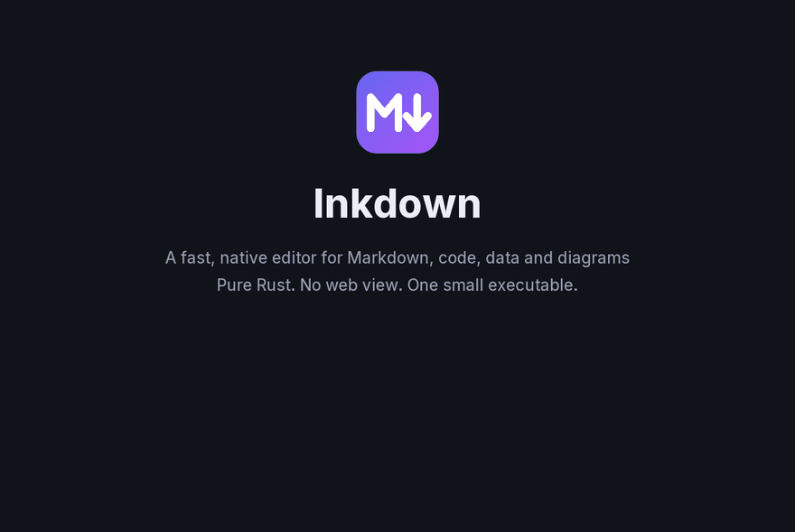
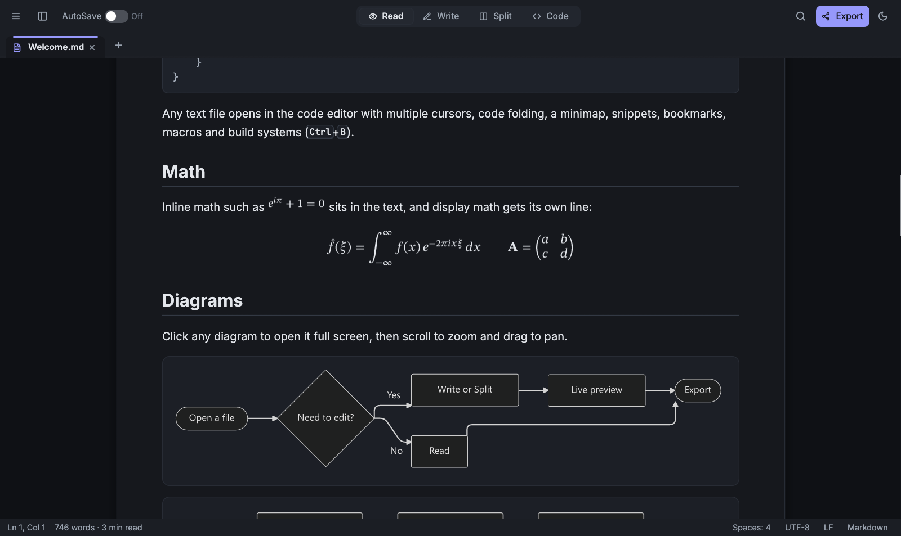
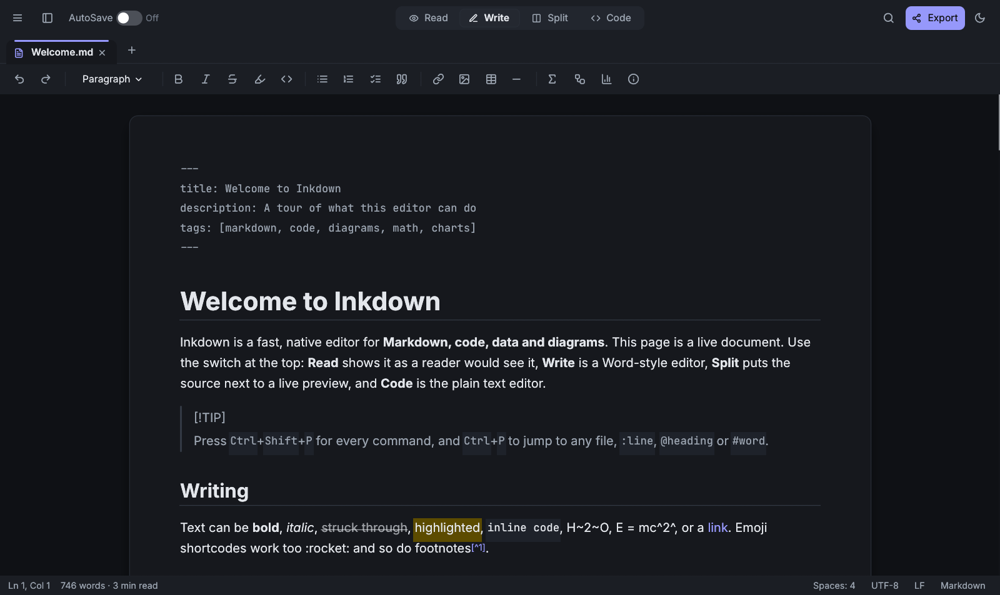
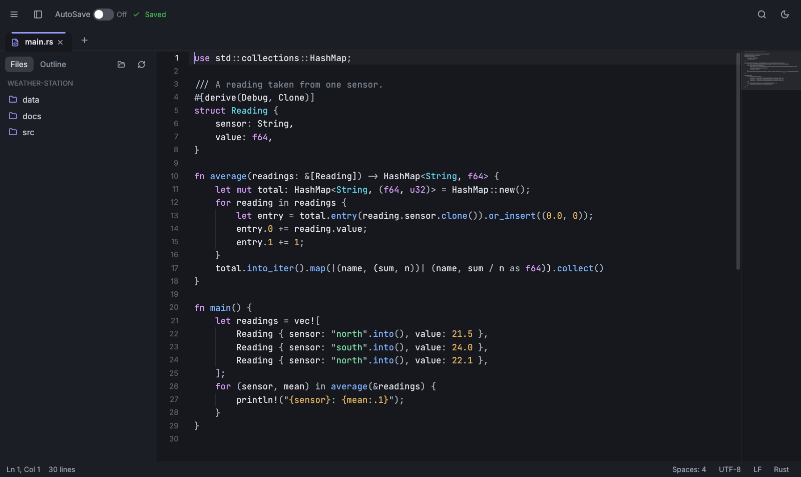
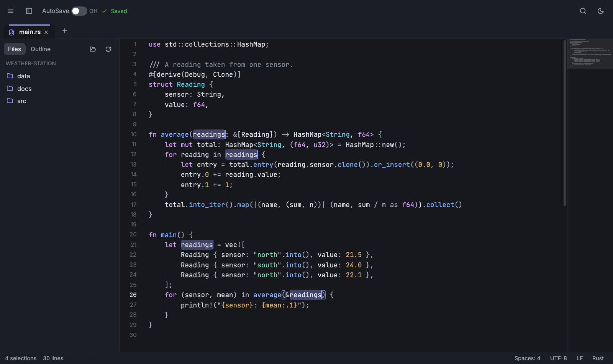
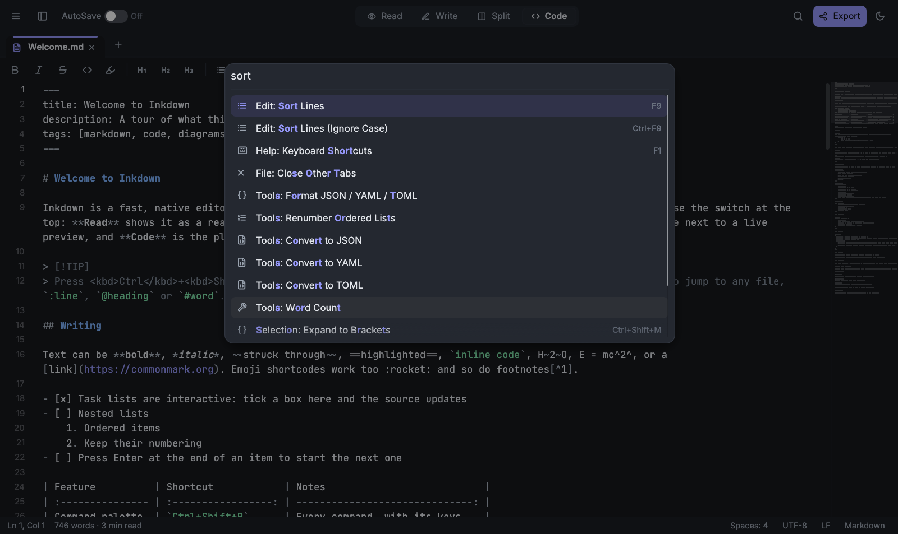
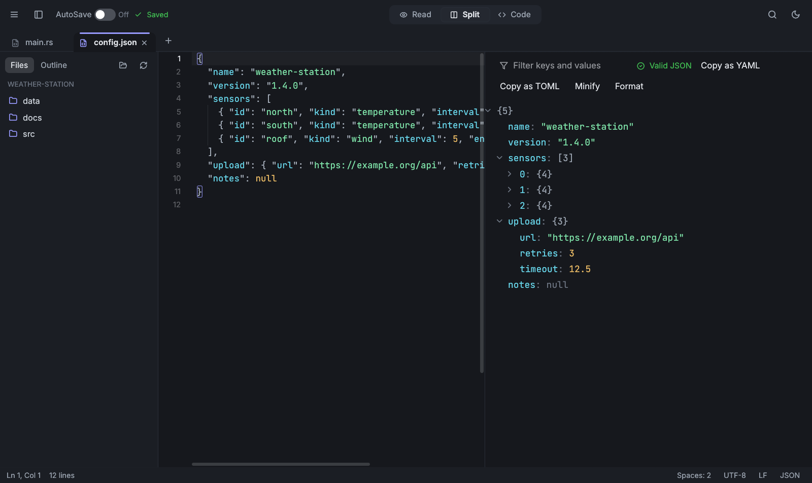
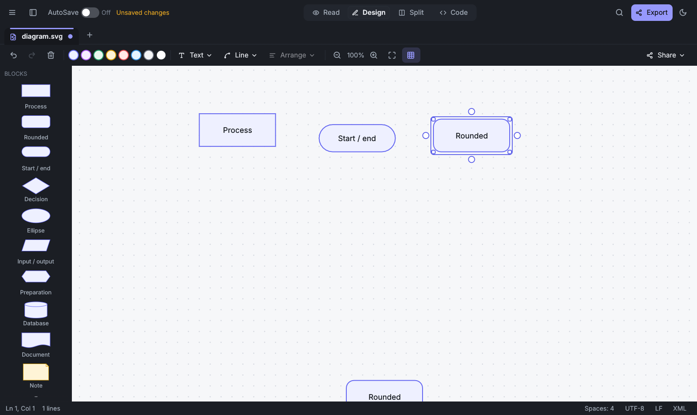
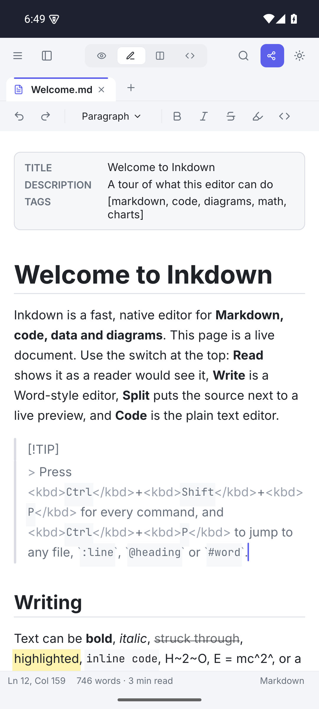
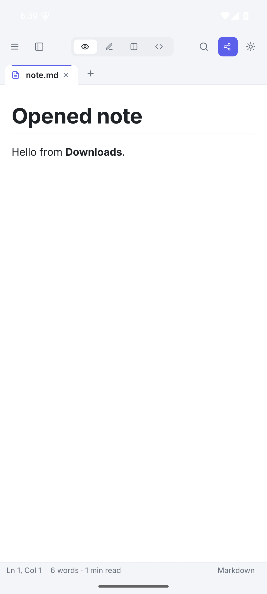

# Inkdown

[](https://github.com/debmalyaroy/inkdown/actions/workflows/ci.yml)
[](https://github.com/debmalyaroy/inkdown/releases/latest)
[](https://github.com/debmalyaroy/inkdown/releases)

A fast, native editor for **Markdown, code, data and diagrams**. Inkdown is written in pure
Rust and draws its own interface: there is no web view and no bundled browser, so it starts
in well under a second and uses a fraction of the memory of an Electron editor.



The animation above is also available as a video: [inkdown-demo.mp4](docs/media/inkdown-demo.mp4)
(1 min 29 s, 1280 x 858).

## Download

**Current release: [v1.0.0](https://github.com/debmalyaroy/inkdown/releases/latest)** ([release notes](docs/releases/v1.0.0.md), [all releases](https://github.com/debmalyaroy/inkdown/releases))

| Platform | Download | Status |
| --- | --- | --- |
| Windows 10 / 11 (x64) | [Inkdown-Setup.exe](https://github.com/debmalyaroy/inkdown/releases/latest/download/Inkdown-Setup.exe) (installer) | **Stable.** Built, installed and tested on Windows 11 |
| Windows, no install | [inkdown-windows-x64.exe](https://github.com/debmalyaroy/inkdown/releases/latest/download/inkdown-windows-x64.exe) (portable) | **Stable** |
| Android 8+ (arm64, x86_64) | [inkdown-android.apk](https://github.com/debmalyaroy/inkdown/releases/latest/download/inkdown-android.apk) | **Beta.** Tested on an Android 15 emulator, not yet on a physical phone |
| macOS 11+ (Apple silicon and Intel) | [Inkdown-macos-universal.dmg](https://github.com/debmalyaroy/inkdown/releases/latest/download/Inkdown-macos-universal.dmg) | **Preview.** Built and unit-tested by CI; not yet used interactively on a Mac |
| Linux (x86_64) | [inkdown-linux-x86_64.tar.gz](https://github.com/debmalyaroy/inkdown/releases/latest/download/inkdown-linux-x86_64.tar.gz) | **Preview.** Built and unit-tested by CI |
| iOS | not built | Planned; needs a Mac to build (see [packaging/ios](packaging/ios)) |

Checksums for every file are in `SHA256SUMS.txt` on the release page.

### Installing

- **Windows.** Run `Inkdown-Setup.exe`. It installs for the current user only (no
  administrator prompt) into `%LOCALAPPDATA%\Programs\Inkdown`, adds a Start menu entry and
  registers Inkdown for Markdown files. Uninstall from *Settings > Apps*. The installer is
  not code-signed yet, so Windows SmartScreen shows a warning on first run: choose
  *More info > Run anyway*. For a silent install use `Inkdown-Setup.exe --quiet`.
- **Android.** Download the APK on the phone and open it; allow installs from your browser
  when asked. The APK is signed with a test key, so it cannot be updated in place by a
  future Play Store build.
- **macOS.** Open the `.dmg` and drag Inkdown to Applications. The build is not notarised:
  the first time, right-click the app and choose *Open*, or run
  `xattr -dr com.apple.quarantine /Applications/Inkdown.app`.
- **Linux.** Unpack the archive and run `./install.sh` (installs to `~/.local`), or run
  `./inkdown` directly.

## What it does

| | |
| --- | --- |
|  **Read.** A clean reader for Markdown: callouts, task lists, footnotes, front matter. |  **Math and diagrams.** LaTeX, Mermaid, Graphviz and charts are drawn natively. |
|  **Write.** Word-style editing with a ribbon. The file stays plain Markdown. |  **Split.** Source and live preview side by side. |
|  **Code.** Sublime-style editor: file tree, minimap, folding, snippets, build systems. |  **Multiple cursors.** `Ctrl+D`, add cursors above and below, split into lines. |
|  **Command palette.** Every command, with its shortcut. |  **Goto Anything.** Files, `:line`, `@symbol`, `#word`. |
|  **Data.** JSON, YAML and TOML as a tree, with validation and conversion. |  **CSV.** Shown as a table next to the source. |
|  **Find in Files.** Search and replace across a folder. |  **Designer.** Draw diagrams; saved as SVG that reopens for editing. |
|  **Two panes.** A document and a source file together. |  **Nine themes.** Light, Dark, Sepia, Solarized, Mint, Nord, Dracula and more. |

**On Android**

| Read | Write | Open with Inkdown | Code, on-screen keyboard |
| --- | --- | --- | --- |
|  |  |  |  |

### Feature list

- **Four modes** for Markdown: Read, Write (Word-style), Split and Code.
- **Markdown**: CommonMark and GitHub tables, task lists, footnotes, callouts, front matter,
  highlight, sub/superscript, emoji shortcodes, LaTeX math.
- **Diagrams**: Mermaid, Graphviz (DOT) and chart code blocks; a visual diagram designer.
- **Editor**: multiple cursors, Sublime Text key map (customisable), minimap, code folding,
  snippets, completions, bookmarks, macros, regex find and replace, Find in Files, Goto
  Anything / Symbol / Definition, build systems, two-pane layout, session restore, AutoSave.
- **Data**: JSON / YAML / TOML tree view with validation, format, minify and conversion;
  CSV / TSV tables; AsciiDoc and HTML preview.
- **Export**: HTML, Word (`.docx`), Rich Text, PDF (through an installed Edge or Chrome),
  copy as rich text, upload to Google Docs with your own OAuth client.
- **Nine themes**, large-file support (a 120,000-line file scrolls at under 8 ms a frame).

### Measured on Windows 11 (release build)

| | Inkdown 1.0 (native) | Earlier WebView prototype |
| --- | --- | --- |
| Executable size | 22.8 MB | 15.2 MB plus the WebView2 runtime |
| Time to first frame | 60 to 80 ms | about 2.6 s |
| Memory, plain text file | 74 MB | about 417 MB |
| Memory, the tour page with diagrams | 105 to 120 MB | about 417 MB |

## Build from source

You need [Rust](https://rustup.rs) (stable). Everything else is fetched by Cargo. The code
is the same on every platform; only packaging differs.

```sh
git clone https://github.com/debmalyaroy/inkdown.git
cd inkdown
make            # release build:  native/target/release/inkdown
make test       # unit tests
make package    # the package for the system you are on, in dist/
make help       # all targets
```

On Windows without `make`, use PowerShell 7: `pwsh build.ps1`, `pwsh build.ps1 test`,
`pwsh build.ps1 package`, `pwsh build.ps1 help`.

| You are on | Command | Result |
| --- | --- | --- |
| Windows | `pwsh build.ps1 package` | `dist\Inkdown-Setup.exe`, `dist\inkdown.exe` |
| macOS | `make macos` | `dist/macos/Inkdown.app`, `dist/macos/Inkdown-<version>.dmg` ([details](packaging/macos/README.md)) |
| Linux | `make linux` | `dist/linux/inkdown-linux-x86_64.tar.gz` |
| Any, with Docker | `make android` | `dist/android/inkdown.apk` ([details](packaging/android/README.md)) |
| Windows, Store | `pwsh build.ps1 msix` | `dist\Inkdown-<version>-x64.msix` (needs the Windows SDK) |

Linux needs a few development packages first:
`sudo apt install pkg-config libxkbcommon-dev libwayland-dev libxcb1-dev libgl1-mesa-dev libfontconfig1-dev`.

### Is the code platform independent?

Yes. The interface, text layout, Markdown, diagram and math rendering are all Rust code
that is compiled unchanged for Windows, macOS, Linux and Android. Platform-specific code is
limited to: the Windows installer and file associations, where settings are stored, how a
browser is located for PDF export, and the Android glue for "Open with". CI builds and runs
the unit tests on Windows, macOS and Linux for every change.

What "it compiles and the tests pass" does not prove is that everything feels right on a
platform nobody has used it on. That is why macOS and Linux are labelled *preview* above.

## Tests

- `make test`: 37 unit tests (text buffer, editing commands, Markdown layout, exports, data
  conversion). Run by CI on Windows, macOS and Linux.
- `pwsh build.ps1 uitest`: 52 end-to-end checks that drive the real window through a
  scripted input driver in an isolated profile: every mode, multi-cursor editing, the
  designer, session restore, exports and performance budgets. Windows only, run locally
  (GitHub's runners have no GPU for the window).
- The release workflow installs and uninstalls the Windows installer silently and fails
  the release if either step leaves anything behind.

## Repository layout

| Path | Contents |
| --- | --- |
| `native/` | **The app**: pure-Rust editor on `egui`. Start here. |
| `src/`, `assets/`, root `Cargo.toml` | An earlier WebView-based prototype (not released). `native/` reuses its export, data and installer modules. |
| `packaging/` | Windows (MSIX), macOS (`.app`, `.dmg`), Linux, Android (Docker), iOS |
| `tools/demo/` | Scripts that capture the screenshots and build the demo video |
| `docs/` | Release notes, screenshots and the demo |
| `.github/workflows/` | `ci.yml` (build and test) and `release.yml` (packages and GitHub release) |

## Making a release

1. Set the version in `native/Cargo.toml` and add `docs/releases/v<version>.md`.
2. Commit, then `git tag v<version> && git push origin v<version>`.
3. The **Release** workflow builds every package, tests the Windows installer, and
   publishes the GitHub release with the notes file and checksums.

## Known limits

- No plugin API or language-server support yet.
- Windows installer and macOS app are not code-signed; the Android APK uses a test key.
- A file can be open in only one pane at a time; layouts have one or two columns.
- PDF export needs Microsoft Edge, Chrome or Chromium installed.
- Write mode shows raw markup for sub/superscript and emoji shortcodes outside the line
  being edited.
- macOS: opening a file from Finder starts the app but does not load the file yet.

## Licence

Copyright (c) 2026 the Inkdown author. All rights reserved; no open-source licence has been
chosen yet. You may read the source and build it for your own use. Bundled fonts and
libraries keep their own licences: see [NOTICE.md](NOTICE.md).
