# Inkdown

[](https://github.com/debmalyaroy/inkdown/actions/workflows/ci.yml)
[](https://github.com/debmalyaroy/inkdown/releases/latest)
[](https://github.com/debmalyaroy/inkdown/releases)

A fast, native editor for **Markdown, code, data, logs and diagrams**. Inkdown is written in pure
Rust and draws its own interface: there is no web view and no bundled browser, so it starts
in well under a second and uses a fraction of the memory of an Electron editor.


The animation above is also available as a video: [inkdown-demo.mp4](docs/media/inkdown-demo.mp4)
(about a minute and a half, 1280 x 858).

## Download

**Current release: [v1.3.0](https://github.com/debmalyaroy/inkdown/releases/latest)** ([release notes](docs/releases/v1.3.0.md), [all releases](https://github.com/debmalyaroy/inkdown/releases))

| Platform | Download | Status |
| --- | --- | --- |
| Windows 10 / 11 (x64) | [Inkdown-Setup.exe](https://github.com/debmalyaroy/inkdown/releases/latest/download/Inkdown-Setup.exe) (installer) | **Stable.** Built, installed and tested on Windows 11 |
| Windows, no install | [inkdown-windows-x64.exe](https://github.com/debmalyaroy/inkdown/releases/latest/download/inkdown-windows-x64.exe) (portable) | **Stable** |
| Android 8+ (arm64, x86_64) | [inkdown-android.apk](https://github.com/debmalyaroy/inkdown/releases/latest/download/inkdown-android.apk) | **Beta.** Tested on a Pixel 10 Pro (Android 17) and an Android 15 emulator |
| macOS 11+ (Apple silicon and Intel) | [Inkdown-macos-universal.dmg](https://github.com/debmalyaroy/inkdown/releases/latest/download/Inkdown-macos-universal.dmg) | **Preview.** Built, unit-tested and put through the scripted UI checks on a Mac by CI; not yet used by a person on a Mac |
| Linux (x86_64) | [inkdown-linux-x86_64.tar.gz](https://github.com/debmalyaroy/inkdown/releases/latest/download/inkdown-linux-x86_64.tar.gz) | **Preview.** Built and unit-tested by CI; the scripted UI checks run in a container |
| iOS | not built | Planned; needs a Mac to build (see [packaging/ios](packaging/ios)) |

Checksums for every file are in `SHA256SUMS.txt` on the release page.

### Installing

- **Windows.** Run `Inkdown-Setup.exe`. It installs for the current user only (no
  administrator prompt) into `%LOCALAPPDATA%\Programs\Inkdown`, adds a Start menu entry and
  registers Inkdown for Markdown files. Uninstall from *Settings > Apps*. The installer is
  not code-signed yet, so Windows SmartScreen shows a warning on first run: choose
  *More info > Run anyway*. For a silent install use `Inkdown-Setup.exe --quiet`.
- **Android.** Download the APK on the phone and open it; allow installs from your browser
  when asked. From 1.0.3 on, every release is signed with the same key, so new versions
  install over the old one. Coming from 1.0.2 or earlier, uninstall once first.
- **macOS.** Open the `.dmg` and drag Inkdown to Applications. The build is not notarised:
  the first time, right-click the app and choose *Open*, or run
  `xattr -dr com.apple.quarantine /Applications/Inkdown.app`.
- **Linux.** Unpack the archive and run `./install.sh` (installs to `~/.local`), or run
  `./inkdown` directly.

## Release notes

| Version | Date | What changed | Notes |
| --- | --- | --- | --- |
| [1.3.0](https://github.com/debmalyaroy/inkdown/releases/tag/v1.3.0) | 2026-11-15 | PDF export without a browser on every platform, search and selection inside PDF files, protected PDF files, true colours at once in huge files, Android fixes from a real phone, UI checks on Linux and macOS | [notes](docs/releases/v1.3.0.md) |
| [1.2.0](https://github.com/debmalyaroy/inkdown/releases/tag/v1.2.0) | 2026-11-15 | PDF reader, logs in colour, Follow, documents and live streams from a web address, large files (background loading, word wrap, find and replace), new home page | [notes](docs/releases/v1.2.0.md) |
| [1.1.0](https://github.com/debmalyaroy/inkdown/releases/tag/v1.1.0) | 2026-11-15 | Unsaved work is never lost (draft files, one window per user), Notes and notebooks, a phone interface, look-around in Find | [notes](docs/releases/v1.1.0.md) |
| [1.0.3](https://github.com/debmalyaroy/inkdown/releases/tag/v1.0.3) | 2026-11-15 | Android package signed with a permanent key, so updates install over the old version | [notes](docs/releases/v1.0.3.md) |
| [1.0.2](https://github.com/debmalyaroy/inkdown/releases/tag/v1.0.2) | 2026-11-15 | Android: working menus, system theme, touch scrolling, file pickers, print, clipboard. Edit menu on every platform | [notes](docs/releases/v1.0.2.md) |
| [1.0.1](https://github.com/debmalyaroy/inkdown/releases/tag/v1.0.1) | 2026-11-14 | Updater, Help menu, fix for commands on read-only documents, GPL licence | [notes](docs/releases/v1.0.1.md) |
| [1.0.0](https://github.com/debmalyaroy/inkdown/releases/tag/v1.0.0) | 2026-11-14 | First public release | [notes](docs/releases/v1.0.0.md) |

The full list is in [CHANGELOG.md](CHANGELOG.md).

## Features and roadmap

Every feature is tracked as a GitHub issue:

- **[Roadmap](https://github.com/debmalyaroy/inkdown/issues/22)**: the overview, with what is released and what is planned.
- **[Released features](https://github.com/debmalyaroy/inkdown/issues?q=is%3Aissue+label%3Ashipped)**: one closed issue per feature, with the version it shipped in.
- **[Planned work](https://github.com/debmalyaroy/inkdown/issues?q=is%3Aissue+is%3Aopen+label%3Aroadmap)**: open issues, grouped by [milestone](https://github.com/debmalyaroy/inkdown/milestones).

## What it does

| | |
| --- | --- |
| 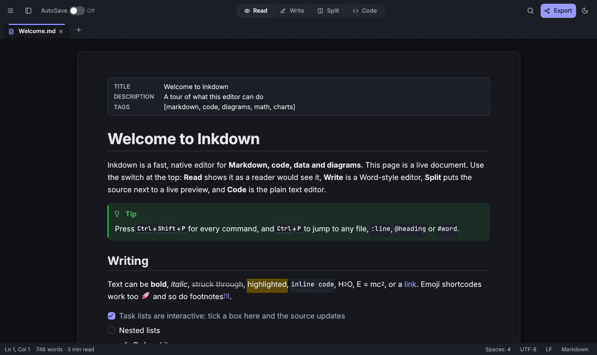 **Read.** A clean reader for Markdown: callouts, task lists, footnotes, front matter. |  **Math and diagrams.** LaTeX, Mermaid, Graphviz and charts are drawn natively. |
|  **Write.** Word-style editing with a ribbon. The file stays plain Markdown. | 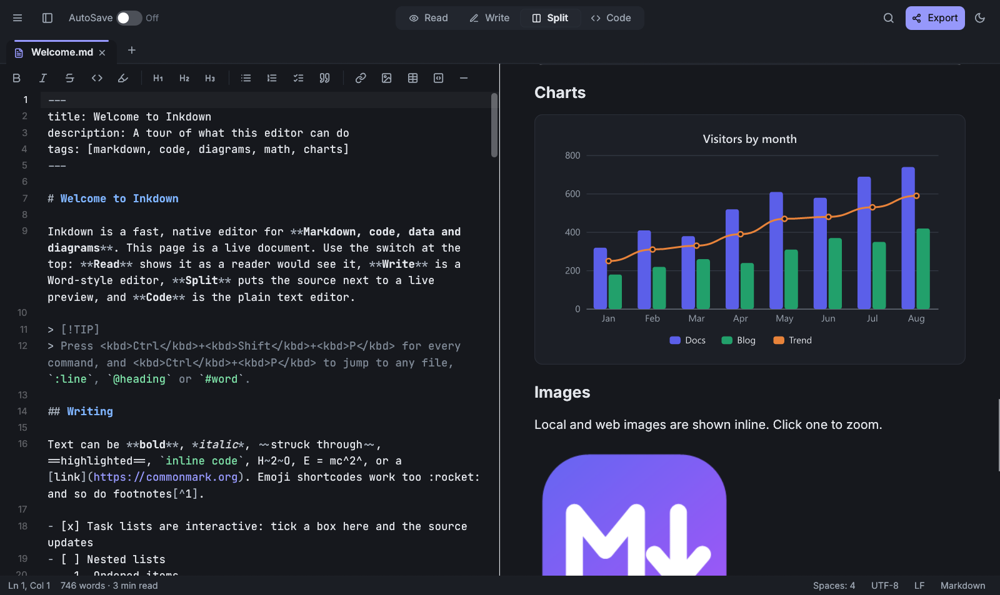 **Split.** Source and live preview side by side. |
|  **Code.** Sublime-style editor: file tree, minimap, folding, snippets, build systems. |  **Multiple cursors.** `Ctrl+D`, add cursors above and below, split into lines. |
|  **Command palette.** Every command, with its shortcut. | 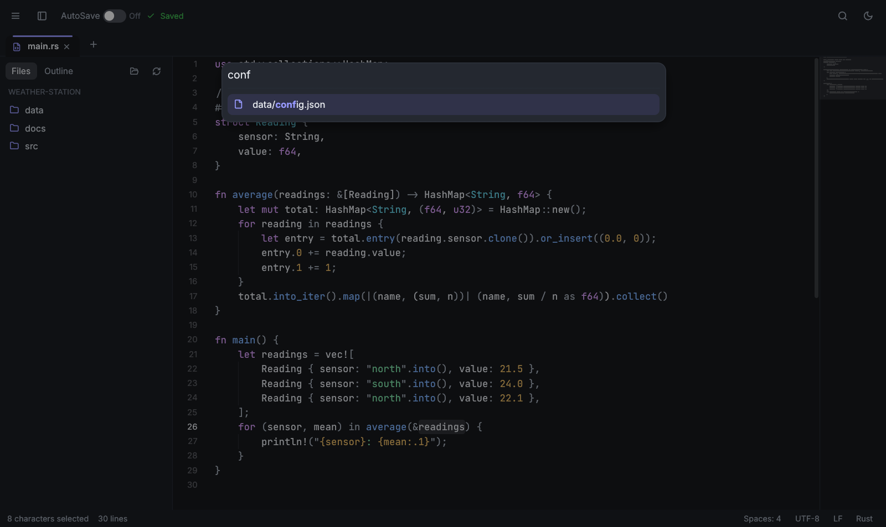 **Goto Anything.** Files, `:line`, `@symbol`, `#word`. |
|  **Data.** JSON, YAML and TOML as a tree, with validation and conversion. | 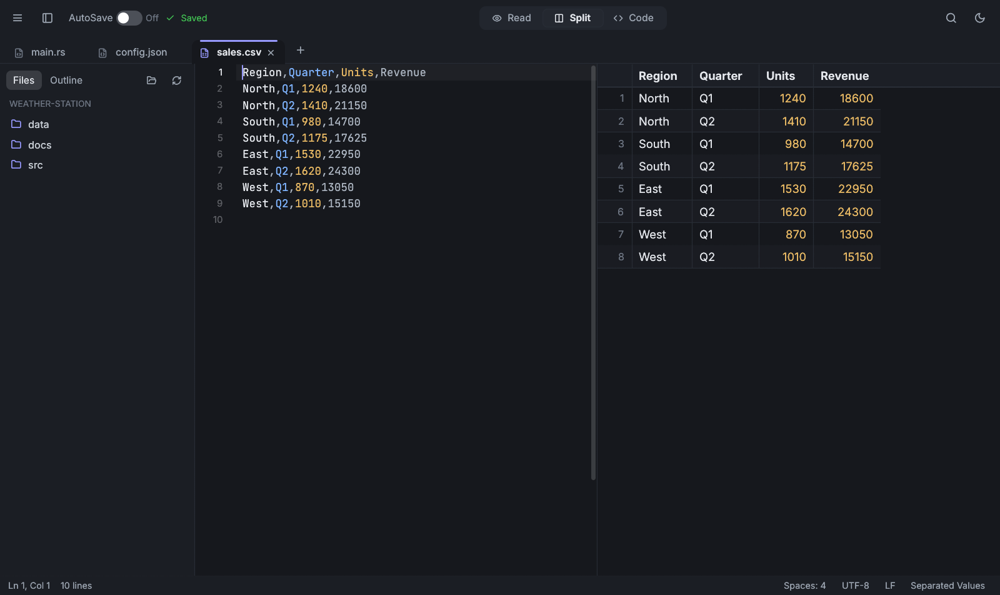 **CSV.** Shown as a table next to the source. |
| 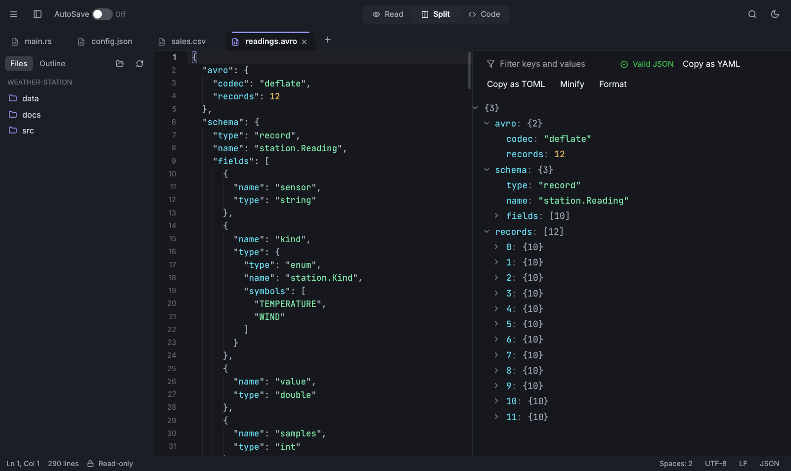 **Avro.** Binary `.avro` data files decoded to a tree: schema, codec and records. | 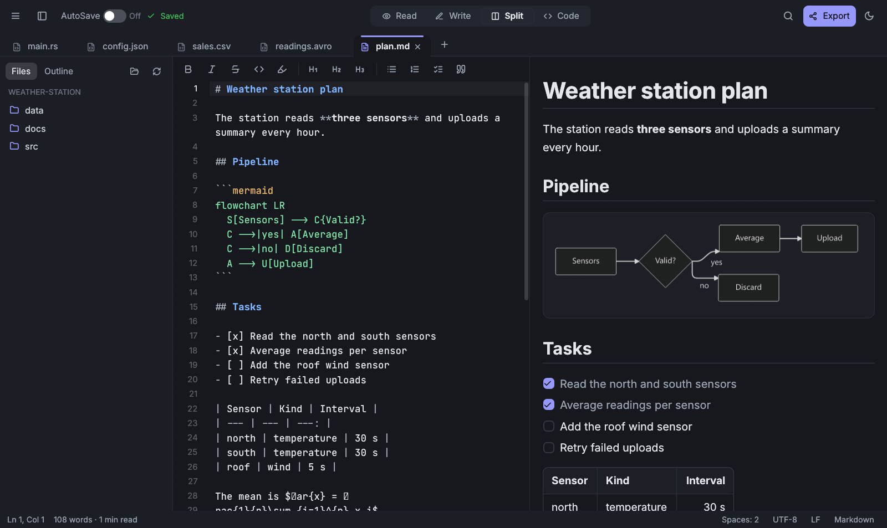 **Project notes.** Documents render with their diagrams while you edit. |
| 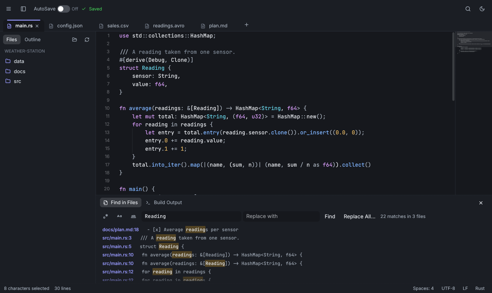 **Find in Files.** Search and replace across a folder. |  **Designer.** Draw diagrams; saved as SVG that reopens for editing. |
| 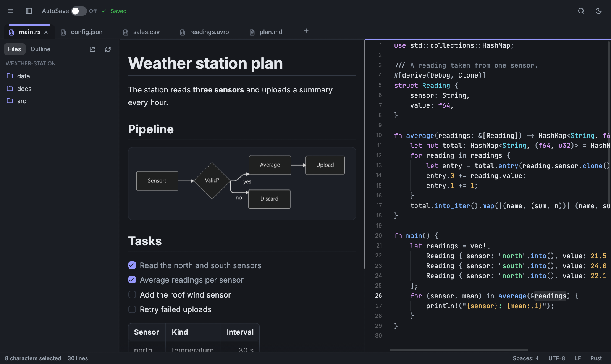 **Two panes.** A document and a source file together. | 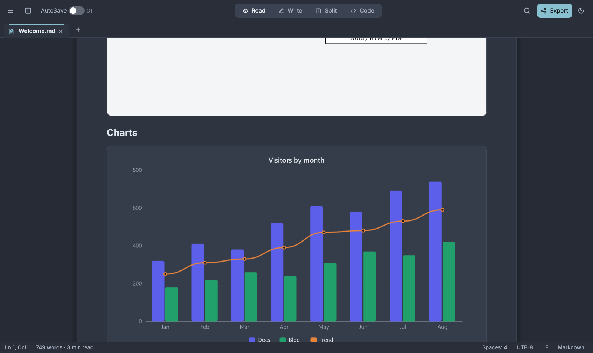 **Nine themes.** Light, Dark, Sepia, Solarized, Mint, Nord, Dracula and more. |

**On Android**

| Read | Write | Open with Inkdown | Code, on-screen keyboard |
| --- | --- | --- | --- |
| 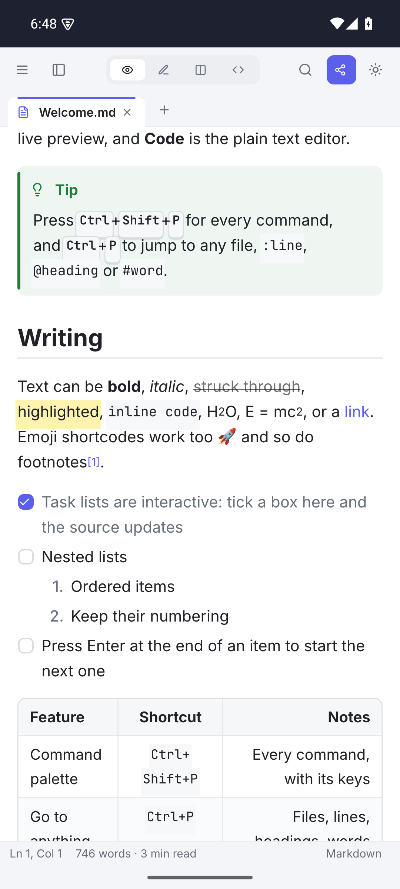 |  |  | 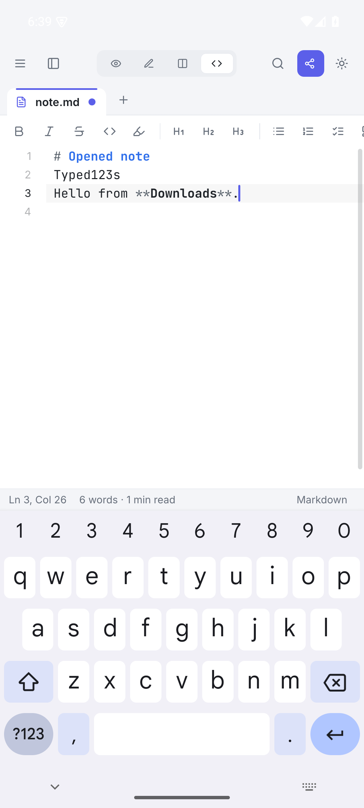 |

### Feature list

- **Four modes** for Markdown: Read, Write (Word-style), Split and Code.
- **Markdown**: CommonMark and GitHub tables, task lists, footnotes, callouts, front matter,
  highlight, sub/superscript, emoji shortcodes, LaTeX math.
- **Diagrams**: Mermaid, Graphviz (DOT) and chart code blocks; a visual diagram designer.
- **Editor**: multiple cursors, Sublime Text key map (customisable), minimap, code folding,
  snippets, completions, bookmarks, macros, word wrap, Find in Files, Goto
  Anything / Symbol / Definition, build systems, two-pane layout, session restore, AutoSave.
- **Find and replace**: plain text, match case, whole word, regular expressions (with
  look-around, back-references and `$1` in replacements), within the selection; Replace
  and Replace All; select all occurrences for multi-cursor editing. Large files are
  searched in the background, completely.
- **Logs**: coloured by severity (errors red, warnings amber, DEBUG dimmed), stack traces
  with their entry, in any common format and at any size. **Follow** shows new lines as
  another program writes them, like `tail -f`.
- **From a web address**: open a document or a log by its `http(s)://` address. It is
  refreshed while open, only what changed is fetched where the server allows it, and a
  connection the server keeps open is shown line by line as it arrives.
- **PDF**: PDF files open as pages with zoom, drawn natively; their text can be searched,
  selected and copied, and files protected by a password ask for it.
- **Large files**: up to 2 GB on desktop. They are read in the background and need about
  1.3 times their size in memory (see the measurements below).
- **Data**: JSON / YAML / TOML tree view with validation, format, minify and conversion;
  CSV / TSV tables; AsciiDoc and HTML preview.
- **Avro**: `.avro` data files open read-only as a tree of schema and records (codecs
  `null`, `deflate`, `snappy`; logical types such as dates, timestamps and decimals are
  shown readably); `.avsc` schemas are edited as JSON. Records or the schema can be copied
  into a new document.
- **Export**: PDF (written by Inkdown itself, on every platform: real text, bookmarks,
  links, diagrams and formulas), HTML, Word (`.docx`), Rich Text, copy as rich text,
  upload to Google Docs with your own OAuth client.
- **Nothing typed is lost**: every unsaved tab and every unsaved change is kept in a draft
  file and restored on the next start, whether the app was closed, crashed or was killed.
  Opening a file while Inkdown runs adds a tab to the running window.
- **Notes**: file a draft as a Markdown note, named after its first line, into a notebook
  in your Notes folder; file all drafts at once; browse and reorganise notebooks.
- **Phones**: a touch interface with the modes along the bottom edge, a formatting strip
  above the keyboard, and bottom sheets instead of menus.
- **Updates**: Inkdown looks for a new release once a day and offers it; on Windows the
  installed copy downloads the installer, verifies its checksum and restarts into the new
  version. *Help > Check for Updates* does it on demand. Turn the daily check off with
  `"check_for_updates": false` in *Preferences > Settings*.
- **Home page**: recent files with their folder, size and age, a filter, and recent folders.
- **Nine themes**.
- **Network use**: Inkdown connects to the internet only to look for a new release (once a
  day, can be switched off), to fetch a web address you open, and for a Google Docs
  upload you start. Nothing about you or your documents is sent anywhere else.

### Measured on Windows 11 (release build)

| | Inkdown 1.0 (native) | Earlier WebView prototype |
| --- | --- | --- |
| Executable size | 22.8 MB | 15.2 MB plus the WebView2 runtime |
| Time to first frame | 60 to 80 ms | about 2.6 s |
| Memory, plain text file | 74 MB | about 417 MB |
| Memory, the tour page with diagrams | 105 to 120 MB | about 417 MB |

Large files, same machine, version 1.2 (a log of 4.1 million lines is the 500 MB row):

| File | Memory once open | Peak while opening | Notes |
| --- | --- | --- | --- |
| No file (welcome page) | 119 MB | 120 MB | idle processor use 0.02 % |
| 10 MB log | 95 MB | 105 MB | |
| 100 MB log | 196 MB | 206 MB | |
| 500 MB log | 656 MB | 667 MB | opens in the background; frames build in about 5 ms while scrolling and typing |
| 500 MB log, word wrap on | 700 MB | 717 MB | 0.8 s to turn on, edits instant |
| 500 MB log, find a word | 690 MB | 719 MB | all 173 020 matches in under a second; Replace All in one step |

## Build from source

You need [Rust](https://rustup.rs) (stable). Everything else is fetched by Cargo. The code
is the same on every platform; only packaging differs.

```sh
git clone https://github.com/debmalyaroy/inkdown.git
cd inkdown
make            # release build:  native/target/release/inkdown
make test       # unit tests
make package    # the package for the system you are on, in dist/
make help       # all targets
```

On Windows without `make`, use PowerShell 7: `pwsh build.ps1`, `pwsh build.ps1 test`,
`pwsh build.ps1 package`, `pwsh build.ps1 help`.

| You are on | Command | Result |
| --- | --- | --- |
| Windows | `pwsh build.ps1 package` | `dist\Inkdown-Setup.exe`, `dist\inkdown.exe` |
| macOS | `make macos` | `dist/macos/Inkdown.app`, `dist/macos/Inkdown-<version>.dmg` ([details](packaging/macos/README.md)) |
| Linux | `make linux` | `dist/linux/inkdown-linux-x86_64.tar.gz` |
| Any, with Docker | `make android` | `dist/android/inkdown.apk` ([details](packaging/android/README.md)) |
| Windows, Store | `pwsh build.ps1 msix` | `dist\Inkdown-<version>-x64.msix` (needs the Windows SDK) |

Linux needs a few development packages first:
`sudo apt install pkg-config libxkbcommon-dev libwayland-dev libxcb1-dev libgl1-mesa-dev libfontconfig1-dev`.

### Is the code platform independent?

Yes. The interface, text layout, Markdown, diagram and math rendering are all Rust code
that is compiled unchanged for Windows, macOS, Linux and Android. Platform-specific code is
limited to: the Windows installer and file associations, where settings are stored,
the one-window-per-user hand-over on desktop, and the
Android glue for "Open with", the file pickers and web requests (Android's own HTTP client
is used there; desktop uses a Rust one). CI builds and runs
the unit tests on Windows, macOS and Linux for every change.

The scripted UI checks drive the real window on Windows, on Linux (in a container) and on
macOS (on a Mac in CI). What they do not prove is that everything feels right to a person
on a platform nobody has used it on. That is why macOS and Linux are labelled *preview*.

## Tests

- `make test`: 61 unit tests (text buffer, editing commands, Markdown layout, exports, data
  conversion, log formats, decoding large files in pieces, PDF pages). Run by CI on Windows, macOS and Linux.
- `pwsh build.ps1 uitest`: 166 end-to-end checks that drive the real window through a
  scripted input driver in an isolated profile: every mode, multi-cursor editing, the
  designer, drafts after a crash, notes, PDF files, log colours, a large file that grows
  while it is followed, documents and streams from a test web server, exports and
  performance budgets. On Windows they are run locally
  (GitHub's Windows runners have no GPU for the window).
- `make linux-uitest`: the same checks for the Linux build, in a Docker container with a
  virtual display and software OpenGL; CI runs them for every change (154 checks), and
  runs them on a Mac as well (142 checks). Timing and Windows installer checks are left
  out there.
- The release workflow installs and uninstalls the Windows installer silently and fails
  the release if either step leaves anything behind.

## Repository layout

| Path | Contents |
| --- | --- |
| `native/` | **The app**: pure-Rust editor on `egui`. Start here. |
| `src/`, `assets/`, root `Cargo.toml` | An earlier WebView-based prototype (not released). `native/` reuses its export, data and installer modules. |
| `packaging/` | Windows (MSIX), macOS (`.app`, `.dmg`), Linux, Android (Docker), iOS |
| `tools/demo/` | Scripts that capture the screenshots and build the demo video |
| `docs/` | Release notes, screenshots and the demo |
| `.github/workflows/` | `ci.yml` (build and test) and `release.yml` (packages and GitHub release) |

## Making a release

1. Set the version in `native/Cargo.toml` and add `docs/releases/v<version>.md`.
2. Commit, then `git tag v<version> && git push origin v<version>`.
3. The **Release** workflow builds every package, tests the Windows installer, and
   publishes the GitHub release with the notes file and checksums.

## Known limits

- No plugin API or language-server support yet.
- Windows installer and macOS app are not code-signed; the Android APK uses a self-generated key, not a Play Store one.
- A file can be open in only one pane at a time; layouts have one or two columns.
- PDF export sets text left-aligned in one column and does not split a table row or a
  picture across pages. Text in a PDF cannot be selected on a phone yet.
- Files larger than memory allows cannot be opened.
- Web addresses that need a login are not supported.
- Write mode shows raw markup for sub/superscript and emoji shortcodes outside the line
  being edited.
- macOS: opening a file from Finder starts the app but does not load the file yet.

## Licence

Inkdown is free software under the [GNU General Public License, version 3 or later](LICENSE).
You may use, study, change and share it. If you distribute Inkdown or a version you have
changed, you must make the source available under the same licence; it cannot be folded
into a closed-source product. For other licensing terms, contact the author.

Bundled fonts and libraries keep their own licences: see [NOTICE.md](NOTICE.md).

## Contributing

Bug reports, fixes and testing on macOS, Linux and real Android phones are especially
welcome. See [CONTRIBUTING.md](CONTRIBUTING.md), the [Code of Conduct](CODE_OF_CONDUCT.md)
and, for vulnerabilities, [SECURITY.md](SECURITY.md).
