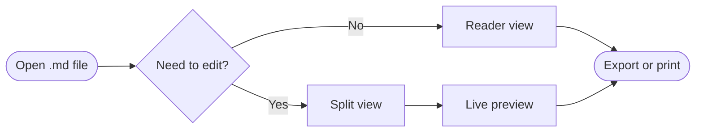
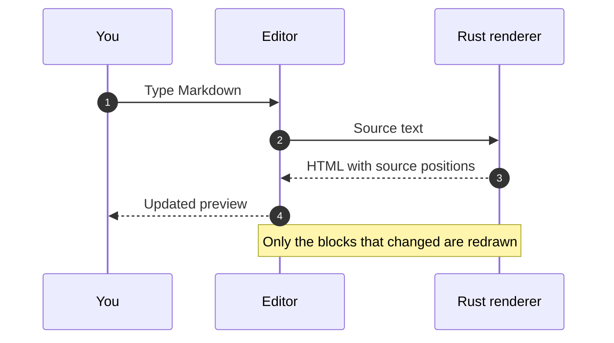
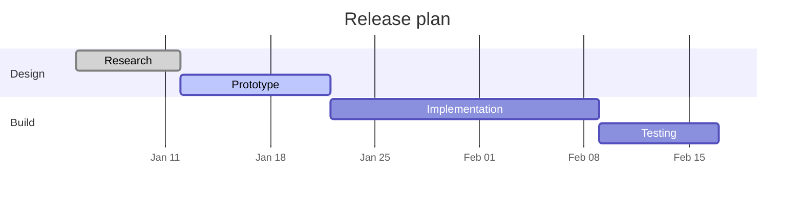
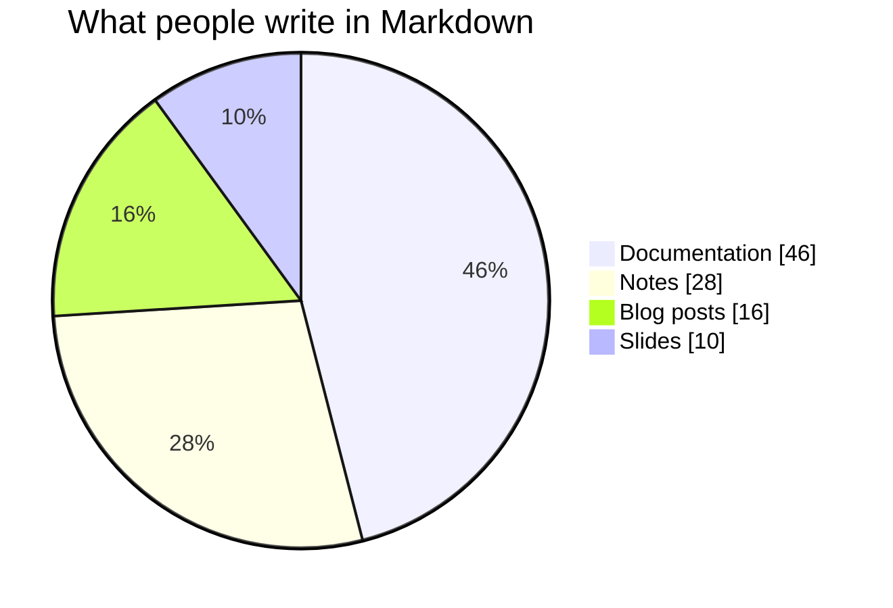
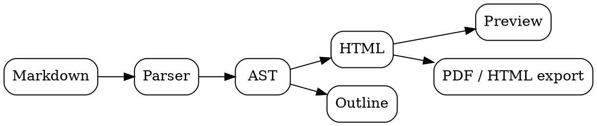

# Welcome to Inkdown

Inkdown is a native **Markdown viewer and editor**. This page is a live document: choose **Write** at the top for a Word-style editor, or **Markdown** to edit the source next to a live preview.

> [!TIP]
> Double-click any paragraph to jump to its source. Press <kbd>Ctrl</kbd>+<kbd>Shift</kbd>+<kbd>P</kbd> for every command.

## Writing

Text can be **bold**, *italic*, ~~struck through~~, ==highlighted==, `inline code`, H~2~O, E = mc^2^, or a [link](https://commonmark.org). Emoji shortcodes work too :rocket: and so do footnotes[^1].

- [x] Task lists are interactive: tick a box here and the source updates
- [ ] Nested lists
    1. Ordered items
    2. Keep their numbering
- [ ] Paste a screenshot straight into the editor

| Feature          | Shortcut         | Notes                         |
| :--------------- | :--------------: | ----------------------------: |
| Reader / editor  | `Ctrl+E`         | Read, split or edit           |
| Find and replace | `Ctrl+F` `Ctrl+H`| Regex and whole-word options  |
| Export           | `Ctrl+P`         | PDF, print or standalone HTML |

Term
: Definition lists are supported as well.

## Code

```rust
/// Syntax highlighting for 70+ languages.
fn fibonacci(n: u64) -> u64 {
    match n {
        0 | 1 => n,
        _ => fibonacci(n - 1) + fibonacci(n - 2),
    }
}
```

## Math

Inline math such as $e^{i\pi} + 1 = 0$ sits in the text, and display math gets its own line:

$$
\hat{f}(\xi) = \int_{-\infty}^{\infty} f(x)\, e^{-2\pi i x \xi}\, dx
\qquad
\mathbf{A} = \begin{pmatrix} a & b \\ c & d \end{pmatrix}
$$

## Diagrams

Click any diagram to open it full screen, then scroll to zoom and drag to pan. Hover for copy and save buttons.









### Graphviz



### Charts

Charts are interactive: hover for values, click legend entries to toggle a series.

```chart
{
  "title": { "text": "Visitors by month" },
  "legend": { "bottom": 0 },
  "grid": { "left": 48, "right": 24, "top": 56, "bottom": 56 },
  "xAxis": { "type": "category", "data": ["Jan", "Feb", "Mar", "Apr", "May", "Jun", "Jul", "Aug"] },
  "yAxis": { "type": "value" },
  "series": [
    { "name": "Docs", "type": "bar", "data": [320, 410, 380, 520, 610, 580, 690, 740], "itemStyle": { "borderRadius": [5, 5, 0, 0] } },
    { "name": "Blog", "type": "bar", "data": [180, 220, 260, 240, 310, 370, 350, 420], "itemStyle": { "borderRadius": [5, 5, 0, 0] } },
    { "name": "Trend", "type": "line", "smooth": true, "data": [250, 310, 330, 390, 470, 480, 530, 590] }
  ]
}
```

### Images

Local and web images are shown inline. Click one to zoom.


### Drawings

Insert > Drawing opens a visual designer: add blocks from the palette, drag from a blue dot to connect them, then save. The drawing lives in the document as SVG and can be reopened for editing.

## More than Markdown

Inkdown also opens JSON, YAML and TOML (with a tree view, validation, formatting and conversion), CSV tables, AsciiDoc, Mermaid and Graphviz files with a live preview, and source code in any language. Use the **Export** button for Word, RTF, HTML, PDF and Google Docs, and the sun icon for themes.

## Callouts

> [!NOTE]
> Highlights information the reader should notice.

> [!WARNING]
> Flags something that needs attention.

<details>
<summary>Collapsible sections work too</summary>

Raw HTML is allowed and sanitised, so documents can never run scripts.

</details>

[^1]: Footnotes are collected at the end of the document.
