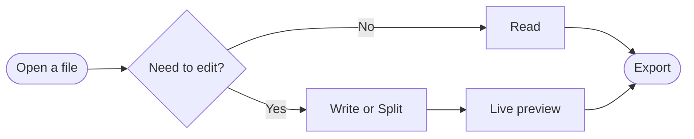
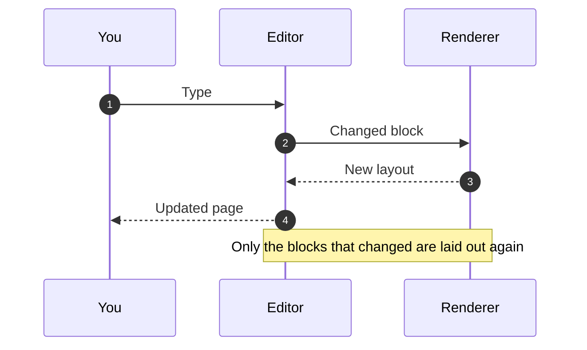
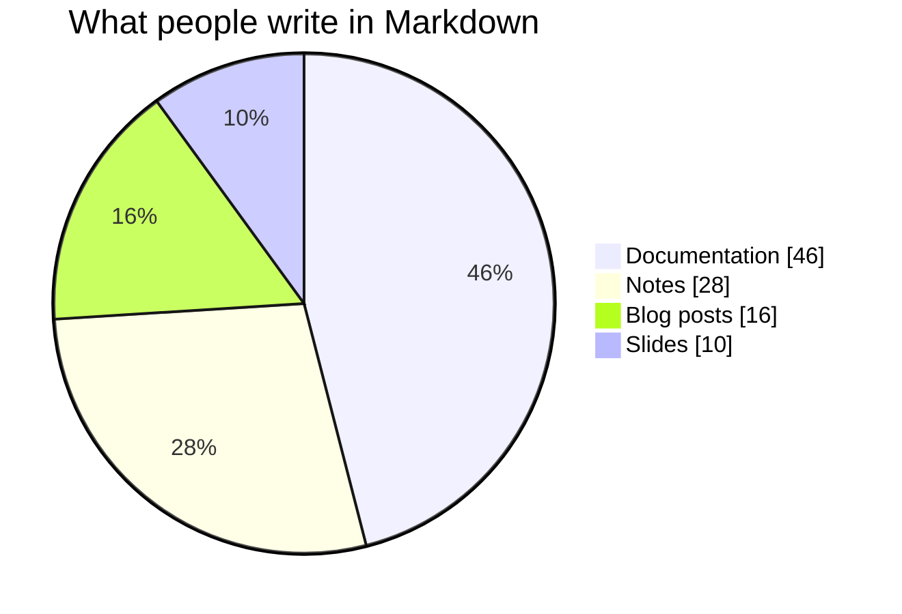
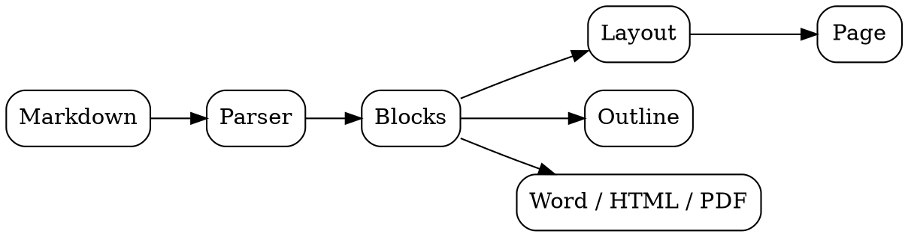

# Welcome to Inkdown

Inkdown is a fast, native editor for **Markdown, code, data and diagrams**. This page is a live document. Use the switch at the top: **Read** shows it as a reader would see it, **Write** is a Word-style editor, **Split** puts the source next to a live preview, and **Code** is the plain text editor.

> [!TIP]
> Press <kbd>Ctrl</kbd>+<kbd>Shift</kbd>+<kbd>P</kbd> for every command, and <kbd>Ctrl</kbd>+<kbd>P</kbd> to jump to any file, `:line`, `@heading` or `#word`.

## Writing

Text can be **bold**, *italic*, ~~struck through~~, ==highlighted==, `inline code`, H~2~O, E = mc^2^, or a [link](https://commonmark.org). Emoji shortcodes work too :rocket: and so do footnotes[^1].

- [x] Task lists are interactive: tick a box here and the source updates
- [ ] Nested lists
    1. Ordered items
    2. Keep their numbering
- [ ] Press Enter at the end of an item to start the next one

| Feature          | Shortcut            | Notes                           |
| :--------------- | :-----------------: | ------------------------------: |
| Command palette  | `Ctrl+Shift+P`      | Every command, with its keys    |
| Go to anything   | `Ctrl+P`            | Files, lines, headings, words   |
| Find and replace | `Ctrl+F` `Ctrl+H`   | Regex, case and whole word      |
| Find in files    | `Ctrl+Shift+F`      | Across the open folder          |
| Multiple cursors | `Ctrl+D` `Ctrl+Alt+↓` | Select next match, add a cursor |

Term
: Definition lists are supported as well.

## Code

```rust
/// Syntax highlighting for 200+ languages, using Sublime Text grammars.
fn fibonacci(n: u64) -> u64 {
    match n {
        0 | 1 => n,
        _ => fibonacci(n - 1) + fibonacci(n - 2),
    }
}
```

Any text file opens in the code editor with multiple cursors, code folding, a minimap, snippets, bookmarks, macros and build systems (<kbd>Ctrl</kbd>+<kbd>B</kbd>).

## Math

Inline math such as $e^{i\pi} + 1 = 0$ sits in the text, and display math gets its own line:

$$
\hat{f}(\xi) = \int_{-\infty}^{\infty} f(x)\, e^{-2\pi i x \xi}\, dx
\qquad
\mathbf{A} = \begin{pmatrix} a & b \\ c & d \end{pmatrix}
$$

## Diagrams

Click any diagram to open it full screen, then scroll to zoom and drag to pan.







### Graphviz



### Charts

```chart
{
  "title": { "text": "Visitors by month" },
  "xAxis": { "type": "category", "data": ["Jan", "Feb", "Mar", "Apr", "May", "Jun", "Jul", "Aug"] },
  "yAxis": { "type": "value" },
  "series": [
    { "name": "Docs", "type": "bar", "data": [320, 410, 380, 520, 610, 580, 690, 740] },
    { "name": "Blog", "type": "bar", "data": [180, 220, 260, 240, 310, 370, 350, 420] },
    { "name": "Trend", "type": "line", "smooth": true, "data": [250, 310, 330, 390, 470, 480, 530, 590] }
  ]
}
```

### Images

Local and web images are shown inline. Click one to zoom.


### Drawings

New from Template > Diagram opens a visual designer: add blocks from the palette, drag from a blue dot to connect them. The drawing is saved as a normal SVG that can be reopened for editing, and copied out as Mermaid.

## More than Markdown

Inkdown also opens JSON, YAML and TOML (tree view, validation, formatting and conversion), CSV tables, AsciiDoc, Mermaid and Graphviz files with a live preview, and source code in any language. Use **Export** for Word, RTF, HTML, PDF and Google Docs, and the theme button for nine colour themes.

## Callouts

> [!NOTE]
> Highlights information the reader should notice.

> [!WARNING]
> Flags something that needs attention.

<details>
<summary>Collapsible sections work too</summary>

Click the summary line to open or close a section.

</details>

[^1]: Footnotes are collected at the end of the document.
