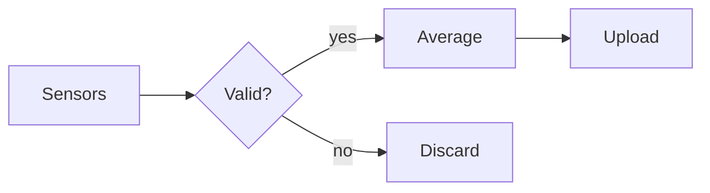

# Weather station plan

The station reads **three sensors** and uploads a summary every hour.

## Pipeline

## Tasks

- [x] Read the north and south sensors
- [x] Average readings per sensor
- [ ] Add the roof wind sensor
- [ ] Retry failed uploads

| Sensor | Kind | Interval |
| --- | --- | ---: |
| north | temperature | 30 s |
| south | temperature | 30 s |
| roof | wind | 5 s |

The mean is $ar{x} = rac{1}{n}\sum_{i=1}^{n} x_i$.
